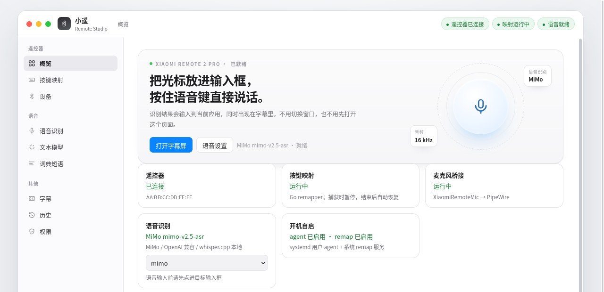
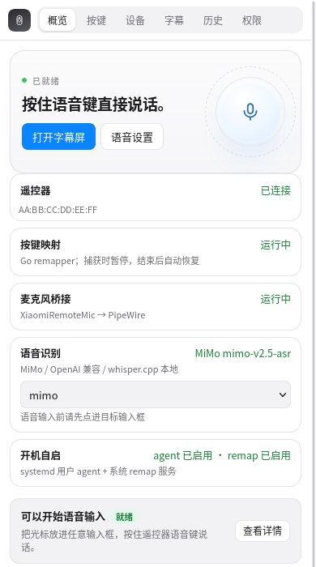
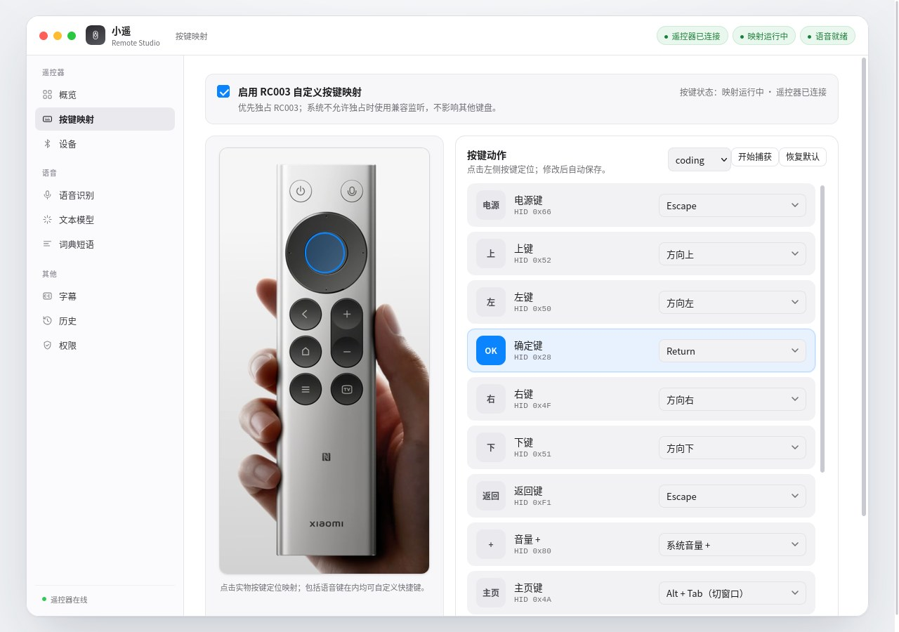

# Open Voice Bridge · 小遥

> Turn a Bluetooth remote — and, soon, a phone — into a local voice input device for Linux.

[](https://github.com/yi-nology/open-voice-bridge/actions/workflows/ci.yml)
[](go.mod)
[](LICENSE)
[](#requirements)

小遥把小米蓝牙遥控器变成一套可长期运行的本地语音输入服务：按住语音键说话，识别结果直接进入当前焦点窗口，同时以歌词样式显示在字幕屏；按键可以完全重映射，不依赖厂商 App。整个管理界面只监听 `127.0.0.1`，API Key 只以文件路径形式保存。

<p align="center">
  
</p>

<p align="center">
  
</p>

## 特性

- **BLE / ATVV 语音**：小米 RC003 / Remote 2 Pro、RC001 / Remote 2、ARN9 等 `2717:32b8` 设备开箱即用；通用 ATVV 遥控器可选 Generic 配置。
- **完整按键重映射**：root helper 独占 evdev 并通过 uinput 注入，支持命名预设、自定义映射、捕获模式与热插拔。
- **可插拔 ASR**：MiMo、OpenAI 兼容接口、whisper.cpp、本地命令；支持 fallback 链与热切换。
- **可选文本后处理**：MiniMax、火山方舟、OpenAI、DeepSeek 或任意 OpenAI 兼容服务；失败时保留原文。
- **个人词典与语音短语**：本地纠正专名、把触发词替换成模板文本；短语按序占用「常用语 1–8」，按键映射里绑定后按一下直接上屏（SayAll 风格的一句话快捷输入，不进历史）。
- **歌词式字幕**：毛玻璃深色屏、逐句高亮、聆听状态、全屏。
- **本地历史**：JSONL 保存最近 200 条，支持搜索、复制、删除与 JSON 导出，不上传。
- **状态与可观测性**：概览、快速检查、最近识别、ASR 耗时、麦克风节点健康；`/metrics` 暴露 BLE、ATVV、麦克风、转写数与时延直方图。
- **多设备**：同时接入多个已启用设备，按 profile 匹配；BlueZ 电量与连接状态。
- **手机作为外置输入设备**：配对后的手机浏览器既是虚拟遥控器（方向 / 确认 / 返回 / 音量），也能按住说话当外置麦克风，音频与遥控器走同一条识别链路，桌面字幕与历史会标出当前说话的是哪台设备。默认关闭，需要在配置里打开 `phone` 段；详见 [设计稿](docs/design/external-input-sources.md)。
- **本地 Agent 访问（只读 MCP）**：在「本地 Agent 访问」面板为每个 AI 客户端创建独立、可撤销的 256-bit 授权，`xiaomi-remote mcp --token …` 以 stdio MCP 提供 `history_list` / `history_search` / `usage_stats` 三个只读工具。撤销即失效；审计只记次数不记内容；响应中的设备地址脱敏。客户端可能把读到的内容发到它的云端，请只授权给信任的客户端。

## 界面

| 按键映射 |
| --- |
|  |

桌面端采用侧栏 + 分组设置；手机尺寸下自动收成一行导航、单列状态卡和整行主操作。设置页只保留「接入 / 模型与凭据 / 高级选项」三组。

## 工作原理

```
物理遥控器
  │ BLE / ATVV (16 kHz ADPCM)
  ▼
BlueZ ──► agent ──► PipeWire 虚拟麦克风 (XiaomiRemoteMic)
              │
              ├──► ASR（MiMo / OpenAI 兼容 / whisper.cpp / 本地命令）
              │        │
              │        ├──► 文本规则 / 词典 / 语音短语
              │        ├──► 可选 LLM 改写
              │        ├──► 粘贴到当前焦点窗口（X11 / Wayland）
              │        ├──► 字幕 SSE 与历史
              │        └──► Prometheus 指标
              │
              └──► 按键：root remap (evdev → uinput)

浏览器（仅 127.0.0.1:8787）──► 管理 UI / SSE / API
```

`internal/agent` 管理 BLE 会话与语音切分；`internal/asr` 是可插拔识别层；
`internal/audio` 维护 `pw-loopback` / `pw-cat`，并在节点丢失时自动重启。
手机/虚拟输入源的设计方向是把音频与按键抽象成 `InputSource`，复用同一条
识别与粘贴链路，详见设计稿。

## 支持设备

| 设备 | 语音 | 按键 | Profile |
| --- | --- | --- | --- |
| 小米遥控器 2 Pro（RC003-MS） | ✅ ATVV | ✅ | `rc003` |
| 小米遥控器 2（RC001-MS） | ✅ ATVV | ✅ | `rc003` |
| 小米/米家语音遥控器（ARN9） | ✅ ATVV | ✅ | `rc003` |
| Google / Android TV / Fire TV / NVIDIA 等 ATVV 遥控器 | ✅ ATVV | 视 evdev 而定 | `generic-atvv` |
| Apple Siri Remote 1 代（A1513 / A1962） | ❌ | ✅ | `apple-siri-remote-1` |

同名设备按 VID/PID（`2717:32b8`）和名称匹配；其他 ATVV 设备可在「设备」页选择 Generic 配置。

## 环境要求

- Linux（验证环境：Raspberry Pi 500 / Debian 13，PipeWire + BlueZ + systemd）
- Go 1.27 或更新版本（仅构建需要）
- X11 或 XWayland（`xsel` 粘贴）；Wayland 原生环境可选 `wtype`
- root 权限仅用于安装 remap 服务
- 首次配对需要 `bluetoothctl`

## 快速开始

### 1. 构建

```bash
git clone https://github.com/yi-nology/open-voice-bridge.git
cd open-voice-bridge
make build
./bin/xiaomi-remote doctor
```

`make build` 产出 `bin/xiaomi-remote`（已被 `.gitignore` 忽略）。二进制名沿用
`xiaomi-remote`，以兼容已有 systemd 服务与脚本；项目对外名称是 Open Voice Bridge。

### 2. 配置

```bash
mkdir -p ~/.config/xiaomi-remote
cp conf/config.example.json ~/.config/xiaomi-remote/config.json
chmod 600 ~/.config/xiaomi-remote/config.json
```

把 `address` 改成你的遥控器蓝牙地址（示例里是占位地址 `AA:BB:CC:DD:EE:FF`），
并按需调整 ASR provider。完整字段见 [conf/config.example.json](conf/config.example.json)。

MiMo 云端识别需要把 API Key 放在单独文件（默认 `~/.config/xiaomi-mimo/api_key`）：

```bash
install -d -m 700 ~/.config/xiaomi-mimo
printf '%s' '你的 MiMo API Key' > ~/.config/xiaomi-mimo/api_key
chmod 600 ~/.config/xiaomi-mimo/api_key
```

服务只读取文件，不会通过网页回显 Key 内容。

### 3. 配对遥控器

```bash
bluetoothctl
> scan on
> pair AA:BB:CC:DD:EE:FF     # 换成你的地址
> trust AA:BB:CC:DD:EE:FF
> connect AA:BB:CC:DD:EE:FF
```

Linux 下除蓝牙配对，还需要让 agent 能打开对应 evdev 设备；remap 服务负责独占与注入。

### 4. 安装服务

```bash
make install-user                 # 用户级 agent
loginctl enable-linger "$USER"    # 可选：未登录也随开机启动
sudo make install-remap           # root remap helper，监听 Unix socket
sudo make install-logrotate       # 可选：日志轮转
```

`install-*` 会把 `deploy/` 模板里的 `@ROOT@` / `@USER@` 替换为当前检出路径与用户，
因此仓库可以放在任意目录。

从 [Release](../../releases) 包安装则免源码、免 make：解压后自带二进制、unit 模板与
`install.sh`。

```bash
tar -xzf open-voice-bridge_<版本>_linux_<架构>.tar.gz
cd open-voice-bridge_<版本>_linux_<架构>
./install.sh                  # 用户级 agent（bin/ + deploy/ 同目录，任意路径可放）
sudo ./install.sh --root      # 可选：remap helper + 日志轮转
```

脚本只替换 `deploy/` 模板并启动服务，不会替你写配置；之后回到上面第 2 步准备
`config.json` 即可。

### 5. 打开界面

```bash
systemctl --user status xiaomi-remote-go
./bin/xiaomi-remote doctor
xdg-open http://127.0.0.1:8787
```

第一次使用建议按首页的「准备步骤」走一遍：确认遥控器、按键映射、麦克风桥接、
语音识别都就绪，然后按住遥控器语音键说一句话。识别结果会粘贴到当前焦点窗口，
并出现在「字幕」页与「历史」页。

## 配置说明

配置文件默认位于 `~/.config/xiaomi-remote/config.json`，JSON 格式。

| 字段 | 说明 |
| --- | --- |
| `address` | 默认/回退蓝牙地址；多设备时以 `devices` 为准 |
| `ui_addr` | 管理界面监听地址，**必须**是 `127.0.0.1` / `localhost` / `::1` |
| `helper_socket` | root remap 的 Unix socket，默认 `/run/xiaomi-remote-helper.sock` |
| `max_utterance_seconds` | 单次录音上限，5–60 秒 |
| `paste_enabled` | 识别完成后是否自动粘贴 |
| `devices[]` | `id`、`name`、`address`、`profile`、`enabled`、匹配规则 |
| `active_device` | 当前主设备 ID |
| `keymap.profile` / `keymap.profiles` | 当前按键预设与命名预设集合 |
| `asr.provider` / `asr.fallback` | 当前 ASR 配置名与故障回退顺序 |
| `asr.providers{}` | `type`（`mimo` / `openai` / `whispercpp` / `command`）、模型、Base URL、密钥文件、超时等 |
| `llm` | 是否启用改写、provider、模型、Base URL、Key 文件、模式与超时 |
| `text.dictionary` / `text.snippets` | 本地词典纠错与语音短语；`snippets` 按序兼任「常用语 1–8」，可绑定 `phrase1`–`phrase8` 按键动作 |
| `phone.enabled` / `phone.addr` / `phone.tls` | 手机输入开关、监听地址与 TLS 模式（`off` 仅接受回环地址） |
| `phone.max_clients` / `phone.max_utterance_seconds` / `phone.pair_code_ttl_seconds` | 手机并发数（1–16）、手机单次录音上限、配对码有效期 |
| `phone.allow_power_key` | 允许已配对手机注入电源键，默认 `false`；改后重启服务生效 |
| `streaming_subtitles` | 边说边滚字：按住期间增量识别刷字幕（S6），默认 `false` |
| `wake_enabled` / `wake_word` | 唤醒词监听（S7）与词面，默认「小遥小遥」 |
| `lookback_enabled` / `lookback_seconds` | 回眸内存环（S8）与窗口秒数（5–60，默认 30） |
| `text.commands_enabled` / `text.commands` | 语音命令（S1）：整句命令词 → 快捷键，默认关 |
| `llm.app_rules` | 应用感知改写（S5）：按前台类名切 `off`/`cleanup`/`format`/`translate` |
| `keymap.app_rules` | 按 App 切键位方案：`class` 匹配前台窗口类名 → `profile` |
| `sink_name` / `source_name` | 虚拟麦克风的 PipeWire 节点名，默认 `xiaomi_mic_sink` / `xiaomi_mic` |

遗留键（仅当 `asr.providers` 为空时补进 `mimo` 配置，新配置请直接写 providers）：
`api_key_file`、`asr_model`、`asr_language`、`asr_base_url`。
`keyd_config` 已废弃（keyd 被 root remapper 取代），保留仅为兼容。

**未知键不会静默吞掉**：启动日志与 `xiaomi-remote doctor` 都会点名被忽略的键，
避免"写了却没生效"的配置陷阱。

密钥永远只以**文件路径**保存；服务端不会把 Key 内容写入日志或 API 响应。

### ASR 预设

界面内置 MiMo、OpenAI Whisper、OpenAI 兼容、本地 whisper.cpp、本地命令五种模板。
选择模板会新建或切换到对应配置，不会覆盖已有配置。

### 文本后处理

支持 MiniMax、火山方舟（Ark）、OpenAI、DeepSeek 与自定义 OpenAI 兼容服务。
改写失败时会保留原始识别结果，不影响粘贴。

## 按键映射

- 内置 `coding` / `minimal` 等预设，可在界面另存命名预设。
- 点击实物照片定位按键，选择目标动作（原生、快捷键、宏、系统动作、常用语）。
- 「常用语 1–8」动作把按键绑到词典短语面板里的第 N 条短语：按一下就把那段文字粘进当前焦点窗口。
- 「开始捕获」期间按键只显示、不注入，结束后自动恢复映射。
- **组合动作**：动作填 `seq(...)` 即把多个步骤依次执行，例如
  `seq(macro(leftctrl+c), 120, enter)`（复制、等 120 ms、回车）；步骤支持
  单键、`macro(...)` 和毫秒延时（0–2000），按住重放整条序列。
- **按 App 自动切换**（切得准）：`keymap.app_rules` 按前台窗口类名匹配键位方案，
  如 `{"class": "firefox", "profile": "media"}`；不匹配时回到当前方案。
  运行时覆盖、不改你的持久配置；仅 X11/XWayland 生效（Wayland 合成器不外露焦点）。
- 电源键默认映射为 Escape；设为「原生」会触发系统关机。手机端的电源键另受
  `phone.allow_power_key` 约束，默认关闭（见「配对手机」）。

## 配对手机

手机浏览器可以当虚拟遥控（方向 / 确认 / 返回 / 音量），也可以按住说话当外置麦克风；
音频与遥控器走同一条识别链路，桌面字幕与历史会标出当前说话的是哪台设备。

1. **开启手机输入**：管理界面「设备 → 输入源 → 手机输入」点「启用手机输入」（等价于
   `config.phone.enabled = true`），保存后**重启服务**生效；监听器随服务启动，
   详见[设计稿](docs/design/external-input-sources.md)。
2. **同一局域网**：手机与这台电脑必须在同一个局域网（同一 Wi-Fi）；手机端口默认
   `0.0.0.0:8788`，配对链接会带上这台机器的局域网地址。
3. **生成配对码**：「手机配对」点「生成配对码」，用手机浏览器打开链接（配对码放在
   `#pair=` 片段里，不进服务端日志），或手动输入 6 位码。配对码短时有效，到期自动刷新。
4. **自签证书只接受一次例外**：手机首次访问会提示证书不受信任——选择「继续访问」
   （iOS 同样只接受一次例外）即可。**不要把这张证书安装或信任为根证书**：它只是
   一年期叶子证书，导入为长期信任会把这台机器的私钥变成通用 CA（见 [SECURITY.md](SECURITY.md)）。
5. **使用**：按住「说话」按钮听写，松开即出字；方向键等控制焦点窗口。多台手机可同时
   配对，说话互斥；遥控器抢麦优先，手机的半句仍会送进识别链路。
6. **电源键默认关闭**：手机页的「电源」按钮默认禁用——注入 `KEY_POWER` 可能被系统
   当作关机请求。确有需要时在配置里把 `phone.allow_power_key` 设为 `true` 并重启服务；
   手机页会随连接自动反映该开关。

排错见[能力矩阵](docs/capability-matrix.md)的症状表（配对失败、证书警告、音频截断等）。
管理页面始终只监听 `127.0.0.1:8787`；撤销配对会立即断开该手机正在进行的会话。

## 本地 Agent 访问（MCP）

1. 打开管理界面「概览 → 本地 Agent 访问」，输入客户端名称并点「创建授权」；
2. 把生成的 JSON 片段粘进客户端的 MCP 配置（token 只显示这一次）；
3. 客户端即可只读查询听写历史与使用统计。随时「撤销」，下一次调用立即失败。

```json
{
  "mcpServers": {
    "xiaomi-remote": {
      "command": "/path/to/xiaomi-remote",
      "args": ["mcp", "--token", "<你的授权>"]
    }
  }
}
```

## Web / API 开发

- REST API 由 Thrift IDL 定义：[idl/xiaomi_remote.thrift](idl/xiaomi_remote.thrift)
- 生成的 OpenAPI：[docs/openapi.yaml](docs/openapi.yaml)
- 管理 UI 与 SSE：`biz/handler/ui`，静态资源与单页在 `web/`
- 修改 IDL 后：

```bash
make idl       # 需要 hz + thriftgo
make openapi   # 需要 thrift2openapi
```

指标端点：`http://127.0.0.1:8787/metrics`，包含 Go 运行时指标与
`xiaomi_remote_ble_connected`、`xiaomi_remote_mic_healthy`、
`xiaomi_remote_transcripts_total`、`xiaomi_remote_asr_duration_seconds` 等。

## 目录结构

```text
.
├── main.go / router.go        # CLI 入口与 hz 路由注册
├── biz/                       # Hertz handlers、router、生成的 API model
├── idl/                       # Thrift IDL（接口唯一来源）
├── internal/
│   ├── agent/                 # BLE 会话、语音切分、转写管线
│   ├── asr/                   # MiMo / OpenAI / whisper.cpp / 命令
│   ├── atvv/                  # ATVV 协议与 ADPCM 解码
│   ├── audio/                 # PipeWire 虚拟麦克风与看门狗
│   ├── bluez/                 # BlueZ D-Bus 状态
│   ├── config/                # 配置加载、迁移与校验
│   ├── device/                # 设备 profile 注册表
│   ├── helper/                # root remap 的 Unix socket 客户端
│   ├── history/               # JSONL 历史
│   ├── llm/                   # OpenAI 兼容改写
│   ├── paste/                 # X11 / Wayland 粘贴
│   ├── remap/                 # root evdev → uinput remapper
│   └── text/                  # 词典与短语规则
├── web/                       # 内嵌 UI（ui.html + assets）
├── conf/                      # 示例配置
├── deploy/                    # systemd / logrotate 模板
├── docs/                      # OpenAPI、设计稿、截图
└── script/                    # install / bootstrap / soak
```

## 发布通道（S9）

- **稳定版**：`vX.Y.Z`（如 `v0.2.0`）——正式发布，默认给所有人。
- **预发布**：`vX.Y.Z-rc.N` / `-beta.N`（如 `v0.3.0-rc.1`）——同一工作流出包，但 GitHub 标记为
  Pre-release，供尝鲜与真机验收；硬件验收通过后再切稳定 tag。

## 开发与测试

```bash
make check     # gofmt + go test + go vet
make build
make soak      # 可选：DURATION=300 script/soak.sh
```

CI 在 Linux 上执行测试与构建，并对 macOS / Windows 做交叉编译检查（语音与按键的
平台实现仅在对应系统启用）。

更多约定见 [CONTRIBUTING.md](CONTRIBUTING.md)。

## 故障排查

| 现象 | 排查 |
| --- | --- |
| `doctor` 报遥控器未找到 | 确认 `bluetoothctl` 已 `pair` / `trust` / `connect`；确认 VID/PID `2717:32b8` 或名称匹配 |
| 界面显示已连接但没有声音 | `pw-dump \| grep xiaomi` 查看 `xiaomi_mic_sink` / `xiaomi_mic`；日志出现 `virtual mic node missing` 会自动重建 |
| 识别成功但没有文字 | 确认目标输入框有焦点；X11 需要 `xsel`；Wayland 原生需 `wtype`；检查 `paste_enabled` |
| `readyz` 为 503 | 查看返回里的 `mic_healthy` / `asr_ready` / `helper_error`；先跑 `doctor` |
| 云端识别 401 | 检查 API Key 文件存在且权限 `0600`；确认 provider / Base URL / 模型名 |
| 按键无反应 | `systemctl status xiaomi-remote-remap`；确认 `/dev/uinput` 权限与 remap 服务 |
| 日志 | `~/.local/state/xiaomi-remote/agent.log`、`journalctl --user -u xiaomi-remote-go`、`journalctl -u xiaomi-remote-remap` |

## 隐私与安全

- 管理 UI / API 只监听回环地址，并校验请求 Host 与 Origin。
- API Key、令牌只保存在本地文件，权限建议 `0600`，不会出现在日志与网页回显中。
- 日志只记字符数、语言、提供商与耗时，不记转写正文；蓝牙地址只记厂商段与末段（`AA:BB:CC:**:**:FF`）。日志文件默认在 `~/.local/state/xiaomi-remote/agent.log`，不落在代码仓库里。
- 语音与文本只会发往你配置的 ASR / LLM 服务；项目本身没有遥测。
- root remap 只监听本地 Unix socket，作用域限于按键注入。
- 安全问题请按 [SECURITY.md](SECURITY.md) 私下报告。

## 路线图

- 手机 / 虚拟设备作为外部输入源（阶段 1 虚拟遥控 + 阶段 2 麦克风已交付，见「配对手机」）
- 每次输入的应用感知模式（邮件、代码、聊天分别改写）
- 更多本地 ASR 与流式识别
- Windows / macOS 的语音链路
- 历史音频回放与更细的输入源管理

## 许可与致谢

本项目以 **GPL-3.0-only** 发布，见 [LICENSE](LICENSE) 与 [COPYRIGHT](COPYRIGHT)。
第三方依赖许可见 [THIRD_PARTY_NOTICES.md](THIRD_PARTY_NOTICES.md)。

UI 与产品方向受到 [nijez/open-voice-bridge](https://github.com/nijez/open-voice-bridge)
的启发；遥控器产品照片仅用于设备识别，不在 GPL 授权范围内（见第三方说明）；本仓库是独立的 Go 实现，与小米官方无关。设备名称与商标归其各自所有者。